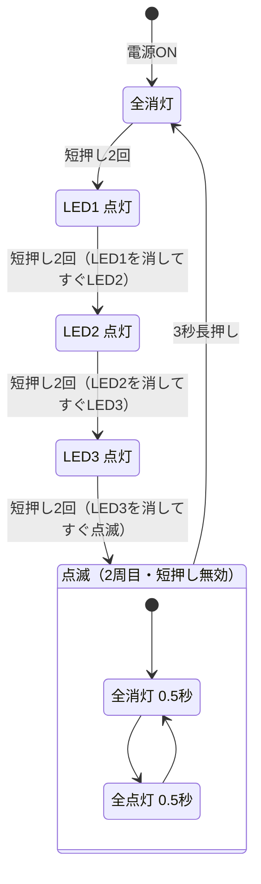
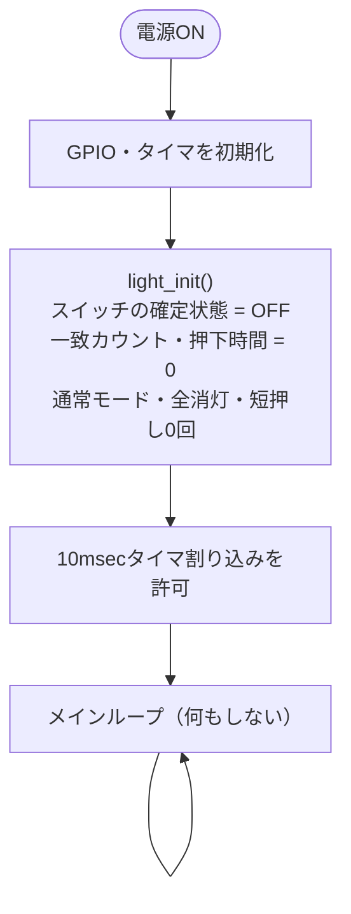
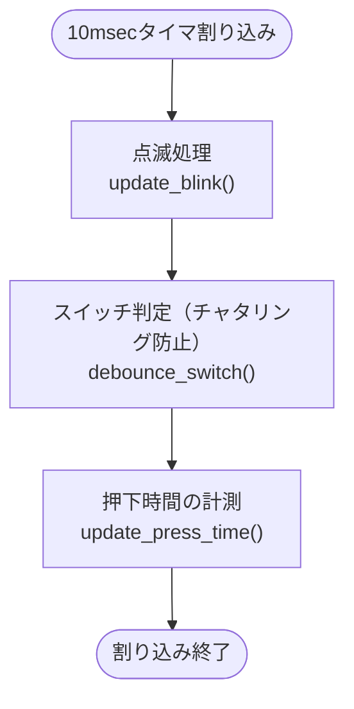
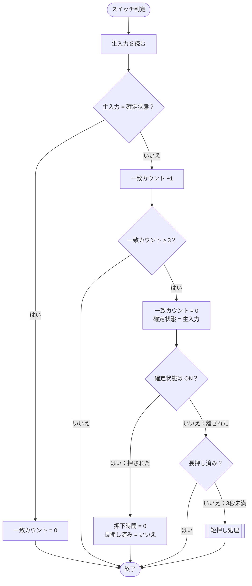
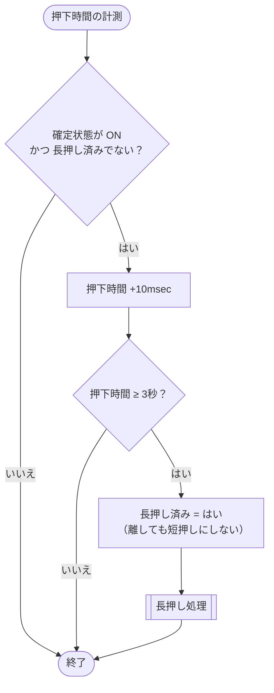
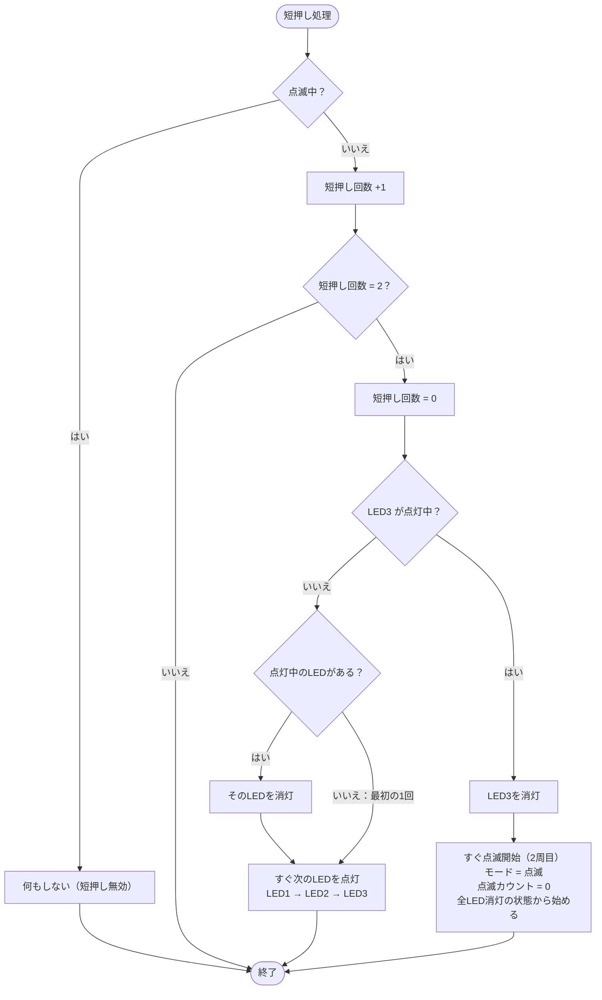
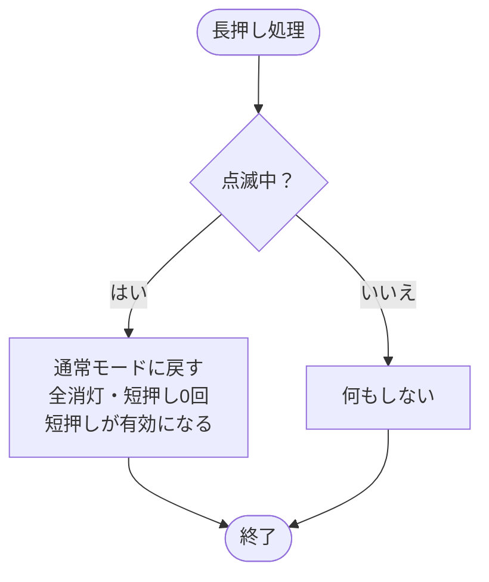
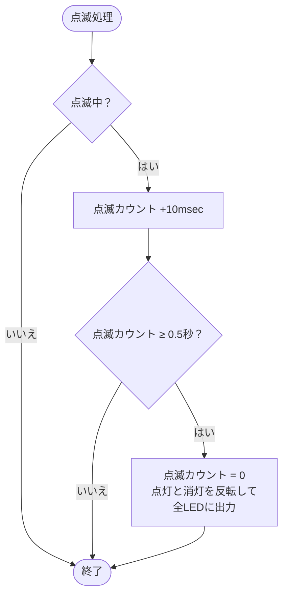

# 3連LEDライト フローチャート

`light.c` の処理を図にしたものです。GitHub 上ではそのまま図として表示されます。

## 全体像（状態遷移）

ライトがとりうる状態と、どの操作で移るかを示します。点滅中の短押しと、点滅していないときの長押しは無視されます（状態は変わりません）。

## 起動処理（`main() / light_init()`）

初期化のあとは何もせず、処理はすべて10msecのタイマ割り込みで行います。

## 10msec タイマ割り込み（`light_tick_10ms()`）

10msecごとに3つの処理をこの順で呼びます。点滅処理を先に置くことで、点滅開始直後の1周期もちょうど0.5秒になります。

## スイッチ判定（チャタリング防止）（`debounce_switch()`）

生入力が確定状態と3回続けて違ったときだけ、確定状態を切り替えます。離したことが確定した時点で、3秒未満なら短押しになります。

## 押下時間の計測（`update_press_time()`）

押している間、10msecずつ数えます。3秒に達した時点で、離すのを待たずに長押しとして処理します。

## 短押し処理（`on_short_press()`）

短押し2回ごとに、点いているLEDを消してすぐ次のLEDを点けます。LED3の次は、LED3を消してすぐ点滅（2周目）に入ります。

## 長押し処理（`on_long_press()`）

点滅中だけ意味があります。点滅していないときの長押しは何もせず、短押しの回数にも数えません。

## 点滅処理（`update_blink()`）

点滅中は0.5秒（10msec × 50回）ごとに全LEDの点灯と消灯を入れ替えます。

